# Xeno-Racer

A realistic racing game for the browser, built for a gamepad. A from-scratch vehicle simulation
running at 1000 Hz, AI drivers that race wheel to wheel, five hand-built circuits from a mountain
pass to a floodlit harbour street circuit and a frozen lake, rain and snow that you can feel through
the tyres, procedurally sculpted cars that crumple when they hit something, working mirrors,
synthesized engine sound, and a TV director that films the race.

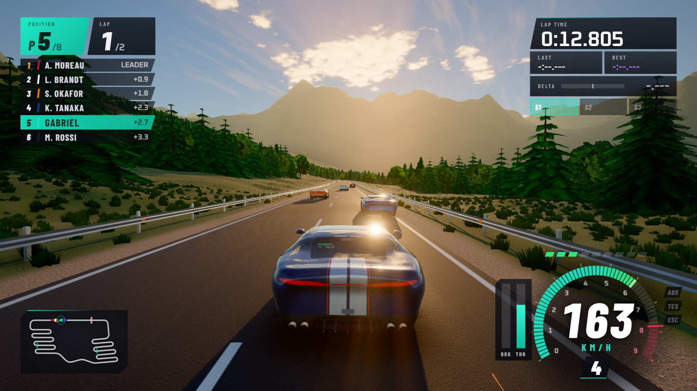

## Play

**In the browser:** play at **https://gabriel-berzescu.github.io/Xeno-Racer/** in Chrome or Edge, with nothing to install.
It is the same game `play.bat` builds, published again on every push to main. A browser lets a page make sound only after a
click or a key press (a gamepad button does not count), so click once or press a key when the game opens; until then the
menus say so. **F11** plays full screen. Settings, best laps, ghosts and the championship are saved in the browser, a save of
their own for each browser (and apart from the save of `play.bat`).

**Windows:** double-click **`play.bat`**. It needs [Node.js](https://nodejs.org) 20+ and Google Chrome.
On the first run it installs dependencies and builds the game, which takes about a minute. It then
opens Xeno-Racer full-screen in its own Chrome window, on the dedicated GPU. To quit, close the
window (**Alt+F4** in full screen).

- Plug in the gamepad and press any button. On a **Logitech F310**, set the switch on the back to **X** (XInput).
- `play.bat --window` plays in a window, `play.bat --build` forces a rebuild, `play.bat --dev` runs from the dev server with hot reload, and `play.bat --serve` only serves the game (open the printed address yourself).

**Any platform:** run `npm install`, then `npm run dev`, and open http://localhost:5199 in Chrome.

## Controls

| | Gamepad (Xbox layout) | Keyboard |
|---|---|---|
| Steer | Left stick | A / D or ← / → |
| Throttle / brake | RT / LT (analog) | W / S or ↑ / ↓ |
| Handbrake | A | Space |
| Nitro (two a lap) | B | E |
| Shift up / down | RB / LB or X (manual gearbox) | Shift / Q |
| Camera | Y | C |
| Look around / look back | Right stick / click right stick | I J K L / V |
| Reset car to track | Back | R |
| Pause | Start | Esc |
| HUD / telemetry | D-pad up / D-pad down | H / T |
| Next track (race music) | D-pad right | N |

Menus use the D-pad or left stick: A confirms, B goes back, and LB/RB step between setup pages and settings tabs (in split screen, either player's pad works in the menus). Settings, Assists has the driving line, the braking assist and a Pro / Standard / Beginner preset, and a tab of its own for player 2 while a second controller is plugged in.
During a replay, LB/RB switch cars, Y changes the camera and B exits. On a pad with rumble
motors (the F310 has none), kerbs, wheelspin and impacts rumble. The race pauses itself when the
window loses focus.

## Modes

- **Race:** up to 11 AI opponents in four skill levels (rookie, amateur, pro, alien). Start-light countdown, pole/middle/back grid slot, 1–50 laps, time of day, weather and a forecast (rain that arrives part way through the race, or clears away). Results come with a full replay.
- **Time trial:** a rolling start, sector splits, and a live delta to your best lap, raced against the ghost of your personal best. Best laps and ghosts are saved per track and car.
- **Championship:** the Xeno Cup, ten rounds over all five circuits, each in different conditions (golden hour, a cloudy morning, a harbour dusk, a winter night under the northern lights at Isvik, a forest morning, dusk rain, a golden hour on the ice that starts in falling snow and clears, night under the floodlights, a cloudy night in Porto Vela where the rain comes during the race, and a thunderstorm finale). A season saved before Isvik joined keeps its eight rounds. Every race scores 25-18-15-12-10-8-6-4-2-1, plus a point for the fastest lap, with the standings and a calendar of winners after each round. Pick your car, difficulty, field (up to 11 opponents who keep their names and liveries all season), race length and how the grid is set. The season is saved after every round, so you can quit to the menu and carry on later, and it ends with a podium and your season summary.
- **Free roam:** the track to yourself.

Opponents drive the same car as you, so the racing is about driving, not horsepower.

## Split screen

Two players, one screen, two controllers. Choose **Split screen** in the main menu (or set **Players** to 2 on the Race step of the Race and Free Roam setup: the setup goes Track, Race, then a car step for each player, the last of which starts the race). Each player picks their own car and livery with their own pad. The second player joins with "Player 2, press A to join" on a second controller; with only one controller, press Enter to play on the keyboard instead, and Y swaps who is player 1 and who is player 2. The time trial and the Xeno Cup stay one-player.

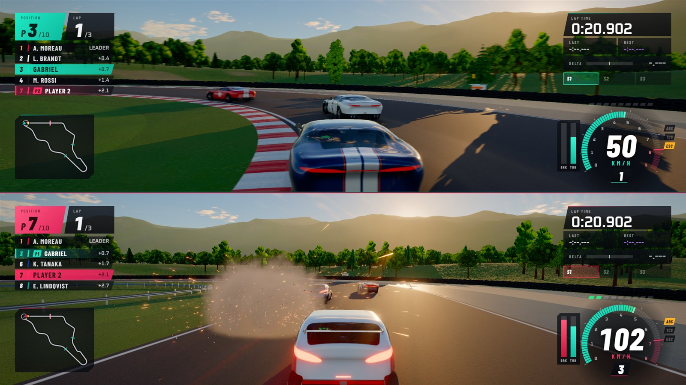

- **Layout:** two wide views, one above the other (each 1920×538 at 1080p), or side by side (Settings, Gameplay: Split screen layout). The lens of each view is set for its shape, so neither looks stretched or like a keyhole. A thin divider runs between them.
- **Everything is per player:** the camera (Y cycles, the right stick looks around, clicking it looks back, and the cockpit, hood and bumper views have their own interiors), the HUD, the spotter, the wrong-way warning, the rain on the windscreen with its wiper, and lap and sector timing. The tower shows both players, in teal and pink, and each minimap shows both. The telemetry overlay and the mirrors are off.
- **The grid:** the two cars start side by side at the position you chose, with up to 10 opponents, who drive the two players' cars in turn. Both players are on the tower, on the minimaps and on the results with their names (each player renames themselves on their car step: A on Driver; or Settings, Gameplay).
- **Assists:** each player has a set of their own (Settings, Assists P1 and Assists P2, each with the Pro, Standard and Beginner presets): one can drive a manual gearbox with nothing to help while the other has ABS, traction and stability control, the driving line and the braking assist on. An older save starts player 2 with what player 1 had, as both drove with before.
- **Pause:** either player's Start pauses the race for both and the pause menu follows the pad that paused. Unplugging a controller pauses the race and says whose it was.
- **Results:** both players in the standings, and a head-to-head card: who beat whom, by how much, and each player's laps. Best laps are saved per track and car for both players, each with its ghost lap for the time trial. No ghost is shown in a split race; the replay is the usual one-screen replay, from any car.
- **Sound:** each player's own engine is the close, full-bodied one; opponents, tyres and impacts are heard from the nearer player's car, and the two engines are a little left and right of each other.
- **Cost:** two views cost about as many pixels as one, but the scene, the shadows and the post chain are drawn twice. On the development laptop (RTX 3050, 1080p, High) a split race takes 8 to 10 ms of GPU a frame (a single-player race 6.6 to 7.4), 99 % of its frames take under 13 ms, and it holds 60 fps with room to spare; the Ultra preset's 1.25 supersampling is run at 1.0 while the screen is split. The shaders of both views are built behind the loading screen, as in a single-player race (it takes about a second longer), and none is built after the lights go out.

## On track

- **Damage:** a hit marks the car where it landed, in proportion to how hard it was. A tap leaves rubber and the other car's paint, a graze scrapes through to primer and bare metal (or frayed carbon), and a hard hit crushes a corner, buckles the bonnet, breaks a light and stars the glass. Every car takes it, the AI's too. Settings, Gameplay: Damage (Off, Visual or Full). Visual is the default.
  - **Full** adds mechanical damage. A hit counts from about 10 km/h of closing speed up, grows with the square of it and is shared out by where it landed, so taps, scrapes and the bumps of a pack race do nothing, and a real crash (a head-on hit from about 60 km/h, a 25 degree hit of a barrier from about 100 km/h) does something you can feel, and a hard one a good deal. It bends the wheels on the side that took it: the car pulls towards that side, it takes a stick held a tenth to a fifth of the way across to run straight, and the tyres scrub and lose a little grip (a bent tail makes it nervous). A car loses only what it has to lose. Up to 40 % of the downforce at the nose or the tail goes on the cars that have some (the LMP-X, the Volta and the Dieci feel it, the Vanta GT hardly); the Kestrel R and the Ronin 86 have a lip and a ducktail that press them down by a few kilos at 250 km/h, and the Mammoth has no downforce at all (its aero is a little lift, which a crash does not take away), so nothing is taken from those three there. A heavy front hit costs up to a tenth of the engine's power in the four front-engined cars (the radiator is behind the grille) and nothing in the mid-engined LMP-X, Volta and Dieci, whose radiators are in their sidepods. It grows smoothly with how hard and how often you hit, and no car ever becomes undrivable: a badly bent one is slower (for an AI driver at the limit, 1 to 4 % of a lap in a road car and 2 to 5 % in the three racing cars) and trickier, and still finishes.
  - A small car outline on the HUD shows what is hurt, amber to red, for a few seconds after a hit, and the pause screen shows it for as long as the car is bent. The outline is the car's own (a teardrop for the road cars, a brick for the Mammoth, a prototype with its two wings for the LMP-X, an open-wheeler with its wings and its wheels out on their arms for the Volta and the Dieci). A part lights only for what the hit cost that car: the nose of a front-engined car without wings (the Kestrel R, the Ronin 86, the Mammoth) is its engine, so it stays dark until a hit reaches the radiator, and its tail, which can only knock the rear wheels a fraction out of line, never reads worse than Light. The bent wheels are drawn leaning out. The AI drives the car it has, and brakes earlier and carries less speed where the lost downforce used to carry it. A restart or the next round of a championship repairs every car, and so does leaving Full (the dents stay in Visual); the Reset button does not repair; the time trial ghost is never hurt. Every mode but Off keeps the record of the hits, so switching to Full from the pause menu in the middle of a race puts on the cars the damage they already carry.
- **Driving line:** a Forza-style racing line on the road ahead (Settings, Assists: Off, Braking zones or Full): the AI's own line and speed profile, worked out for your car (an LMP-X brakes later than a Ronin) and the water on the road, drawn as chevrons that fade into the distance. Green means keep going, amber lift or brake soon, red brake now, measured against your speed, so it asks for earlier braking in the rain and follows a changing forecast. It shows in the chase, far chase, hood, bumper and cockpit views (not the TV, orbit or replay cameras, the photo mode or the attract race), and each split-screen view shows its own player's line. It costs no measurable GPU time (under 0.1 ms at 1080p High) and builds no shader after the lights go out.
- **Braking assist:** (Settings, Assists; off by default, meant for a young driver.) Brakes the car, smoothly and through ABS, when it comes into a corner faster than the driving line allows, and lifts the throttle while it does. You still steer and accelerate, and your own harder brake wins. The BRK bar shows what it adds in blue, with a "brake assist" cue. With the throttle flat out and the brake never touched, a car whose steering follows the line (the AI's path follower at the wheel, with the Beginner aids) laps all five circuits, dry and wet, in all seven cars without a reset, and all but two of those 70 runs without a wall hit or more than 0.8 m past the edge of the asphalt: at Kuroyama in the wet the LMP-X and the Volta run wide out of the hairpin at 3.4 km (the counter-steer aid adds lock on top of the path follower's own, and their front tyres run at nearly three times their peak slip angle) and touch the wall twice at 2 m/s (`tests/probes/brake-assist.test.ts`).
- **Mirrors:** in the cockpit, a working interior mirror and door mirrors (the LMP-X has a rear-camera screen on the dash and the Taccola one where the mirror would hang; the Volta has two mirrors on stalks from the chassis and the Dieci two on stalks from the front of its sidepods, and nothing inside their open cockpits); in the hood and bumper views, a mirror strip at the top of the screen. Headlights behind you glare in them at night and rain beads on them.
- **Nitro:** every car carries two shots of nitro a lap (B on the pad, E on the keyboard). A shot burns for four seconds: half as much torque again and a push from the bottle, both with the throttle, so lifting or braking takes it away. In the Volta a shot is its electric motor instead: up to 350 kW (470 hp) more, with the throttle. The tank fills again as you cross the line (a shot you did not use is not carried over, and backing over the line fills nothing). Flames with a blue glow at the tip come out of the tail pipes (the Dieci's out of its two periscopes, up and back; the Volta's boost burns nothing: the lights on its rear wing pulse instead), the camera opens up, and the NITRO gauge above the speedometer shows the shots left and drains while one burns. The AI drivers have nitro too: they fire it on a straight, flat out, with nothing to brake for within reach and nobody ahead in their lane, and while it burns they drive to what the corners ahead and their brakes allow (`tests/probes/nitro-probe.test.ts` races the same grid with and without it on every circuit). Settings, Gameplay, Nitro turns it off for every car on track: the gauge goes, and B and E do nothing.
- **Spotter:** the edge of the screen glows amber, then red, while a car is alongside you.
- **Cameras:** chase, far chase, hood, bumper, cockpit, TV and orbit. The right stick looks around, and clicking it looks back.
- **Replays:** every race can be watched again from start to finish, from any car and camera.

## Music

Xeno-Racer has an album of its own: instrumental race music, composed in code and synthesized sample by sample (no recordings), which plays **shuffled whenever you drive**, on any circuit: a race, a time trial, free roam or a championship round, through the results and the replay. Every song plays once before any plays again and never the same one twice in a row, and the order carries on where it stopped last time. A restart keeps the song that is playing; going back to the menus fades it out and brings the menu theme back.

- **Next track:** D-pad right (either player's, in split screen) or **N** skips to the next song, with a short fade. The pause menu has a **Next track** item too and says what is playing, and the music drops by 10 dB while the game is paused.
- **Now playing:** when a song starts, a small card in the corner above the minimap shows its title, its genre and the album ("♪ Neon Overdrive, Cyberpunk · Xeno-Racer Vol. 1") for about five seconds. In split screen it is shown once, in player 1's view.
- **Volume:** Settings, Audio: **Race music** (0 turns it off, and nothing is rendered then) and **Menu music**, the theme of the menus, which keeps its own slider.

## Cars

All eight are original designs, and their figures are measured in the simulation, not just quoted:

| | Layout | Power | Weight | 0–100 km/h | Top speed | Skidpad |
|---|---|---|---|---|---|---|
| **Vanta GT**: twin-turbo V8 grand tourer | Front-mid engine, RWD | 610 hp | 1480 kg | 4.6 s | 340 km/h | 1.08 g |
| **Kestrel R**: turbo hot hatch | FWD | 320 hp | 1320 kg | 5.6 s | 270 km/h | 1.01 g |
| **Ronin 86**: naturally aspirated boxer coupé | RWD | 240 hp | 1200 kg | 6.6 s | 254 km/h | 0.99 g |
| **LMP-X**: V10 prototype with real downforce | Mid-engine, RWD | 690 hp | 950 kg | 2.6 s | 318 km/h | 1.92 g |
| **Mammoth**: supercharged V8 4x4 on all-terrain tyres | Front engine, AWD | 710 hp | 2450 kg | 3.8 s | 260 km/h | 0.89 g |
| **Volta**: 2026-rules turbo V6 single-seater with active aero | Mid-engine, RWD | 565 hp (+470 on nitro) | 800 kg | 2.4 s | 330 km/h | 2.39 g |
| **Dieci**: 2004-style V10 single-seater | Mid-engine, RWD | 912 hp | 640 kg | 2.6 s | 332 km/h | 2.64 g |
| **Taccola**: V12 road hypercar on semi-slicks with an active wing | Mid-engine, RWD | 986 hp | 1340 kg | 2.9 s | 384 km/h | 1.30 g |

The **Mammoth** is the odd one out on purpose. Its 6.2 L supercharged cross-plane V8 drives all four wheels (40:60 through a locking centre differential), so it launches like nothing else: 0–100 km/h on Isvik's packed snow in 5.6 s, where the two-wheel-drive cars need about ten. Its all-terrain tyres keep far more of their grip on grass, gravel, sand and deep snow than road tyres do, so cutting a corner costs it the least, and around Isvik only one road car is quicker, the Taccola, by 2–3 %. On asphalt it pays for all that: 2.45 tonnes on long, soft springs lean 5° at the limit, squat under power and dive under braking, and in fast bends it gives way to the Vanta and badly to the LMP-X. It sounds like what it is: a true dual exhaust lets each bank of the cross-plane V8 be heard (the lumpy idle and the burble), with the whine of the blower rising over it. Boxy body, flared arches, a roof light bar that lights with the headlamps, a snorkel, orange tow hooks and recovery boards, a spare wheel on the tailgate, side exhausts (the nitro flames come out sideways) and beadlock wheels on lugged tyres.

The **LMP-X** and the **Volta** run on racing slicks and the **Dieci** on grooved dry tyres, whose four grooves give it no more tread for loose ground than a slick has: they are the stickiest tyres in the game on asphalt, kerbs and concrete (1.9, 2.4 and 2.6 g in the skidpad) and next to nothing off them. A smooth face of soft rubber has no tread to key into grass, dirt or gravel and rides on the film of water over turf, so a slick keeps about a quarter of its asphalt grip on grass, dirt and gravel (the LMP-X 0.4 g and the Volta and the Dieci 0.44 on grass, where the road cars hold 0.55–0.6 and the Mammoth 0.7), under a sixth of it on wet turf, and a wide smooth tyre digs into gravel and sand: a prototype that runs wide into a gravel trap is beached, where a Vanta drives out and a Mammoth does not notice. Off the road the order is Mammoth, road cars, racing cars; on it, the other way round. On Isvik every car, the three racing cars included, runs studded winter tyres, and the slicks' rule for loose ground does not apply.

The **Volta** is a 2026-rules single-seater: 800 kg, open wheels, a halo over an open cockpit, and wings whose flaps open by themselves on a straight taken flat out above 150 km/h and close for a lift, the brakes or a corner (22 % less drag: 330 km/h flat out, 303 with them shut). Its power in the table is the 1.6 L turbo V6 alone. Its 350 kW electric motor is its nitro: a shot adds up to 470 hp, all of it to 290 km/h and none from 345, in place of the bottle, so with the nitro off nothing is missing, and on every circuit only the Dieci is quicker. On slicks like the LMP-X's it corners harder the faster it goes (2.5 g at 150 km/h, 3.7 at 240) and stops from 100 km/h in 18.8 m; the AI drivers lap the road circuits 4–6 % quicker in it than in the LMP-X, and Isvik, on studded tyres, level with it. In the cockpit the yoke has a live display and fifteen shift lights, the halo's central pillar is drawn faint, as two eyes see past it, and the mirrors stand on stalks; the hood view is the T-camera over the airbox, the bumper view a nose camera. With no windscreen the rain beads on the lens and the car is heard through a helmet: a hard, high rasp to 12,500 rpm with no muffler, seamless shifts and, on a nitro shot, the motor's whine. The boost throws no flame; the LEDs on the rear-wing endplates pulse while it deploys.

The **Dieci** is a single-seater of 2004, the last years of the V10s: 640 kg with its driver and an average fuel load, fixed wings, grooved tyres on 13-inch rims and nothing electric. Its 3.0 L V10 makes 912 hp at 18,500 rpm, shifts at 19,000 and is cut at 19,300, and its nitro is the ordinary bottle, so with the nitro off nothing is missing. Its launch control holds 10,000 rpm off the line: 0–100 km/h in 2.6 s (2.5 from a grid start, the engine already held against the clutch), 200 in 4.7 s, about a second before the Volta, and 332 km/h flat out. It is the stickiest car here and corners harder the faster it goes: 2.64 g on the skidpad, 2.7 g at 150 km/h, 3.4 at 200 and 4.3 at 250. Flat out at the limit of a bend from 150 to 240 km/h it has more power than its rear tyres hold: with the default aids it steps out about 16 degrees and is caught, losing speed, where the Volta holds 2–3 degrees (the Volta and the LMP-X drift as much only up to about 150 km/h); at 200 km/h four fifths of the pedal hold it at 5 degrees, and at 280 it stays planted flat out. It stops from 100 km/h in 18.3 m and pulls 4.7 g braking from 300. The AI drivers lap the road circuits 5.8 % quicker in it than in the Volta (7–8 % on Aurelia and Brennwald, 3.6 % on the tight Kuroyama) and Isvik, on studded tyres, 1–3 % quicker: it is the quickest car on every circuit.

It looks the part of 2004: a high pointed nose with the front wing hung under it on two pylons, undercut sidepods with a periscope exhaust on top of each, a tall airbox, a deep engine cover with no fin, a rear wing of two elements over a beam wing, no halo, and the four grooves of its dry tyres in the tread, with white lettering on the sidewalls. Two small LEDs in the tip of the nose light the way at night, and a rain light stands on the tail. In the cockpit the eye sits 73 cm up, just over the high sides, behind a 2004 steering wheel with ten shift lights along its top edge, a small backlit display of the revs, the gear and the speed, and coloured buttons and rotary switches; the mirrors stand on stalks at the front of the sidepods, where the Volta's land on the screen, and the hood view is the T-camera on the airbox, the bumper view a camera on the high nose. Heard from outside or through the helmet, it screams to 19,300 rpm through its two short open exhausts, an octave above everything else here, with a short cut of the ignition at every upshift, a blip at every downshift and pops on the overrun; its launch control, traction control and stability control cut the spark rather than the throttle, so the grid and a slow exit stutter.

The **Taccola** (the jackdaw) is the road car at the top: a mid-engined hypercar with number plates, 1340 kg, rear-wheel drive, and a 6.4 L naturally aspirated V12 that makes 986 hp at 10,000 rpm and is cut at 10,600. It leaves the factory on semi-slicks, the road-legal track tyre, half way between a road tyre and a racing slick in everything. Warm and dry they hold 1.30 g on the skidpad, and with its downforce 1.44 g at 150 km/h, 1.62 at 200 and 1.80 at 250 (714 kg of it by then): more than any road car and well under the LMP-X at every speed. Cold they hold four fifths of that for the first corners; in standing water they keep 59 % of it where the Vanta's road tyres keep 66 %; and on grass and gravel they are worse than a road tyre, but not beached like a slick. Its rear wing stands pitched for the corners and the brakes and lies down flat over the tail on a straight taken flat out, by the Volta's rule: 384 km/h with it down, the fastest car here in a straight line, and 352 with it up. 0–100 km/h takes 2.9 s, which is what two driven tyres allow, 200 km/h 6.1 s and 300 km/h 12.6 s; it stops from 100 km/h in 27.1 m and pulls 2.3 g braking from 300. With the default aids it is the friendliest fast car here: it holds its line flat out in a bend where the Vanta drifts. Without the traction control it steps out under power in second and third, progressively, and a lift turns it in a little. The AI drivers lap the road circuits 9–15 % quicker in it than in the Vanta GT in the dry and 5–9 % in a storm, and 7–16 % slower than in the LMP-X.

It is drawn as what it is: a beak of a nose between two pontoons, with an open channel each side that climbs to the windscreen; a teardrop canopy with a scoop on its roof; a spine from the scoop to the tail with a valley each side; a scallop down each flank under a crisp shoulder, deepening into the intake ahead of the rear wheel; a lamp across the whole tail over four tailpipes and a diffuser; and nine-bladed wheels over calipers of a pale grey, the jackdaw's eye. At night it is a blade of light over a round lamp on each side and a red line across the tail. From the cockpit the two pontoons rise either side of the view, as in a prototype, and a display where the mirror would hang shows the rear camera, since the spine fills the view behind. It sounds like nothing else here: two banks of six, each through its own pipes, a layered howl that climbs without a step to 10,600 rpm, with the induction roaring from the scoop over the driver's head, a clean break at each upshift, a blip at each downshift and hardly a pop on the overrun.

## Tracks

- **Aurelia Ring** (4.79 km, 14 corners) is a grand-prix circuit around a lake. It has a 940 m main straight into a hairpin, flowing esses, a banked carousel, a chicane and a downhill braking zone. Floodlit at night.
- **Kuroyama Pass** (5.25 km) is a mountain road climbing 140 m through twelve switchback hairpins, with a ridge section, a tunnel and a fast descent. The road is narrow and guard-railed.
- **Brennwald Ring** (6.84 km) is a fast, old-school circuit cut through pine and beech forest. It plunges 650 m downhill into the Kessel compression, climbs the steep Kesselwand and a kilometre-long uphill straight to a hairpin, then goes over a blind crest, through a fast double apex and a chicane before the line. 90 m of elevation change.

- **Porto Vela** (3.96 km) is a floodlit street circuit through a Mediterranean harbour town, between concrete walls and catch fences. A 660 m quay straight ends in a heavy braking zone, then the road climbs through the old town past a cathedral at a tight hairpin, dives through a 210 m tunnel under the castle hill and comes down an 8 % descent to a chicane by the marina. The windows light up at dusk.

- **Isvik Circuit** (4.28 km, 16 corners) is a winter circuit in the far north, the way ice racing is done in Sweden and Finland: packed snow between ploughed snowbanks, a frozen lake and a fishing village of red cabins. A 435 m start straight leads into flowing sweepers through the spruce, each one a little too fast for the grip, over a crest to the long fast right of Skogen and then 775 m flat out across the ice of Lake Isvattnet between rows of snowbank markers. A heavy braking zone from the ice leads to two switchback hairpins up the north shore and into the village. 12 m of relief. Every car runs studded winter tyres. Floodlit at night, under the northern lights.

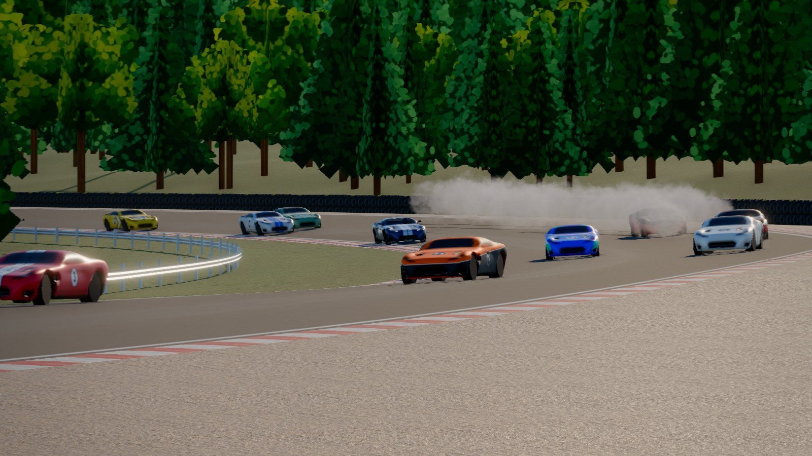
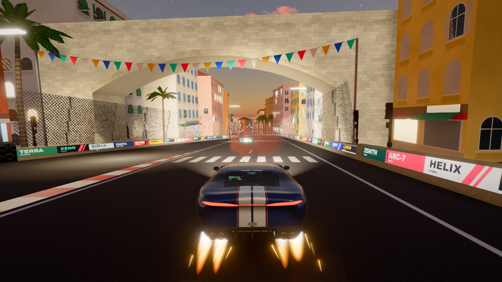
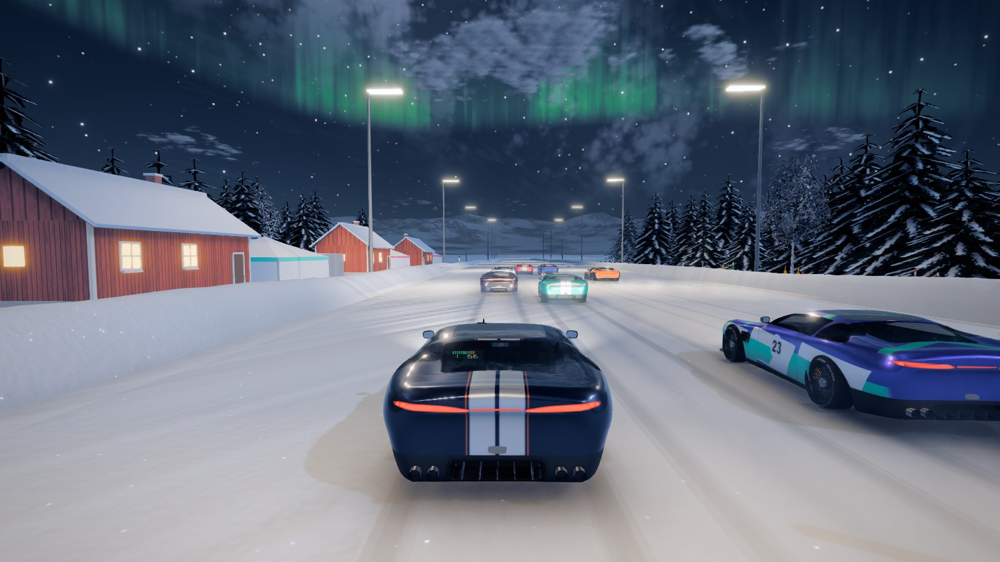

Six times of day (dawn to night) and five weathers (clear, cloudy, overcast, rain and storm; at
Isvik the rain is snow and the storm a blizzard), all lit by a physically based sky.

## Rain

Rain changes how the car drives as well as how it looks:

- **Grip:** measured on the skidpad, wet tarmac keeps 54-85 % of the dry grip, depending on the car
  and how wet it is. Stopping from 100 km/h needs 16-61 % more distance. Standing water makes the
  car aquaplane at speed. Kerbs, painted lines and grass are slippery. The water cools the tyres,
  and their working temperature drops by about 30 °C.
- **AI drivers:** they brake earlier, carry less speed and stay off the kerbs.
- **Visuals:** the sky closes into a low, dark cloud deck. The track darkens and shines, and puddles
  reflect the lights and ripple. Cars throw up spray and rooster tails. Droplets bead on the
  paintwork and slide up the windscreen in the cockpit view, where the wiper sweeps them away (the
  open cockpits of the Volta and the Dieci have no windscreen: the drops bead on the lens, and there is no wiper).
- **Storms:** visibility drops to a few hundred metres, and lightning lights up the clouds, with the
  thunder rolling in a moment later.
- **Sound:** the rain patters or roars, drums on the roof from inside the car, and the tyres hiss
  and spray. In the cockpit the wiper motor whines and the blade thunks at each end of its sweep.
  The drivers of the Volta and the Dieci, in a helmet under the open sky, hear the rain as it sounds
  outside the car, and no wiper.
- **Records:** wet best laps and ghosts are kept apart from dry ones. In a race whose weather changes, a lap counts as wet if the track was wet at any point of it.

## Snow and ice

Isvik Circuit changes how the car drives, not only how it looks:

- **Grip:** measured on the skidpad, packed snow holds 0.46-0.56 g, half of what asphalt does, and the frozen lake 0.37-0.44 g (the heavy Mammoth the least of both). Deep snow beside the road holds 0.32 g and drags the car back. Stopping from 100 km/h takes 57-71 m on snow and 70-88 m on ice with ABS. 0-100 km/h takes 9.6-10.6 s on snow and 12-13.5 s on ice with the traction control on low; without it the driven wheels spin the whole way. The four-wheel-drive Mammoth does it in 5.6 and 6.9 s.
- **Studded winter tyres:** every car wears them at Isvik, whatever it wears elsewhere. A studded tyre is not a slippery summer tyre. Its grip peaks later (at 10 degrees of slip, against 6 to 8) and falls away gently, so a car slides without letting go, and it hardly minds load. The rear-drive Vanta and Ronin swing their tails out when you lean on the throttle in a corner and spin if you stand on it, the front-drive Kestrel pushes wide, and the downforce of the LMP-X and the two single-seaters helps at speed and not at all in the hairpins. ABS, traction control and stability control work on 0.4 μ as they do on asphalt.
- **Snowbanks, not walls:** a bank slows the car over a metre or two and gives it back gently (a hit at 100 km/h and 30 degrees is 6.6 g, where a wall is 13), and a car that goes in far enough is stopped by the frozen ground under it. Damage is a wall's, at a third of the speed. The deep snow at the foot of the bank drags and bogs a car down.
- **AI drivers:** they know the grip under every point of the lap (the ice is slower than the snow), change lanes at the pace the grip allows, ask the throttle for what the corner leaves the driven axle, keep clear of the edge, and catch a slide by pointing the wheels where the car is going. The quickest ones lap in 2:15 (Dieci), 2:20 (Volta, LMP-X), 2:28 (Mammoth), 2:29 (Ronin), 2:31 (Vanta, Kestrel), running up to 9 degrees of body slip and counter-steering for up to a tenth of the lap (`WINTERLAPS=1 DIFF=alien npx vitest run tests/probes/winter-laps.test.ts`).
- **The driving line and the braking assist** know the grip too: at Isvik the line asks 0.4 g in the corners on snow and a third of a g on the ice, and goes amber and red where a car on snow has to brake, which is half as hard as on asphalt, and two fifths on ice. The ribbon is a little more opaque on the snow, where the headlights and the floodlights would wash it out.
- **Snow, not rain:** at Isvik the Rain weather is a snowfall and the Storm a blizzard, in the setup, on the HUD and in the forecast ("Snow later"). Fresh snow lies on the packed road as water lies on asphalt: a heavy fall costs 14 % of the grip and builds up with a lap's lag, but nothing aquaplanes and the tyres do not change.
- **Look:** a low sun and a blue hour over snow that gives the light back (blue shadows, a sparkle, wind-blown ripples), spruce, pine and birch laden with it, snowbanks lumpy along the whole road, a frozen lake with cracks and a polished lane, red cabins, flags and crowds, floodlights and an aurora at night. The cars throw powder, their exhausts steam in the cold, the flakes streak towards the lens, and on the glass the snow melts to a few small drops.
- **Sound:** snow crunches under the tyres at a rate that follows the speed, studs rattle on the ice, a sliding tyre hisses where asphalt squeals, a snowbank is a low whump, and the snowfall is a wind.
- **Records:** best laps on fresh snow are kept apart from the ones on a packed road, as wet laps are.

### Weather that changes

The setup's **Forecast** row (Stable, Rain later, Clearing) makes the weather move during a race. It is offered where it makes sense: rain later from a dry start (clear, cloudy or overcast), clearing from rain or a storm, in races of two laps or more and in free roam.

- **Rain later:** the race starts dry. Somewhere between 30 and 65 % of the way through (by the leader's progress) a notice says "Rain is coming", the sky darkens over a minute, and about 35 s later the first drops land on the windscreen. The rain builds for one to two minutes into a shower or, now and then, a storm. The track takes the water with a lag of about a lap, so grip fades over a lap or two, the AI drivers brake earlier as it goes, and spray and puddles grow.
- **Clearing:** the race starts wet. The rain eases and stops, the cloud deck lifts, and the track dries a good deal more slowly than it wet, over several minutes.
- **Smooth, and the same every time:** the sky, light, fog, exposure, rain, sound and the water on the road all move continuously, the lightning only strikes in storm-strength rain, and a restart repeats the same weather. A broadcast notice marks the moment, and a chip under the lap timer shows the sky and how wet the track is. Both the dry and the wet look are prepared behind the loading screen, so nothing is compiled or switched on once the race is running.
- **Free roam** brings the change in a minute or two after the start. A time trial stays as set.

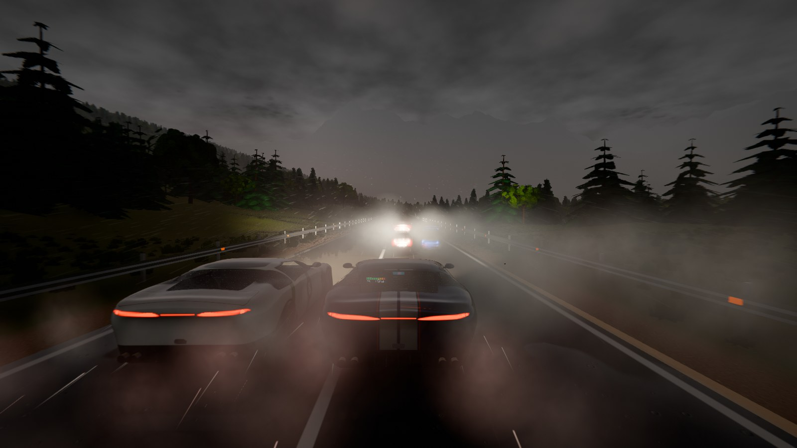
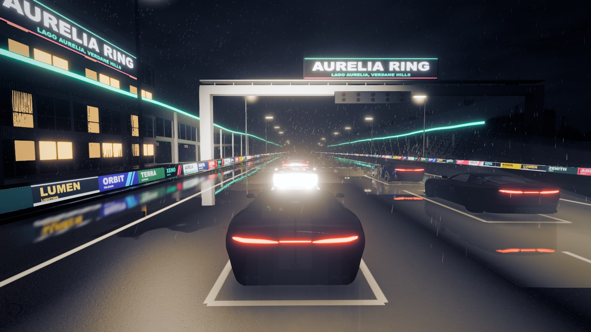
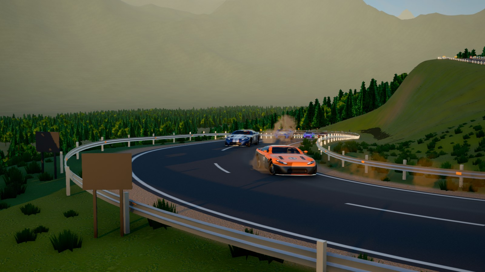
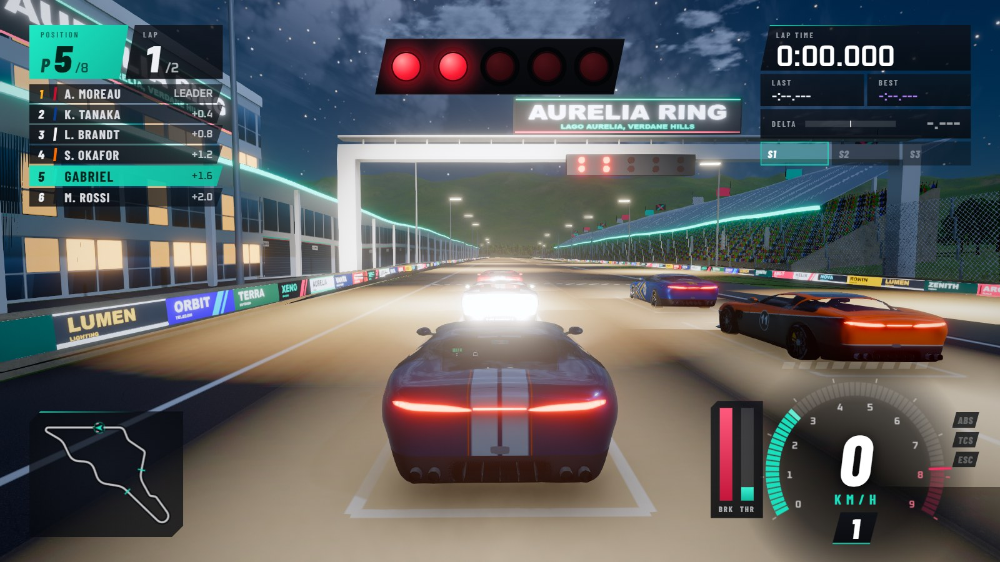

## Under the hood

- **Vehicle physics** (`src/physics`) is written from scratch and steps at 1000 Hz:
  - **Tires:** combined-slip tire model with relaxation length, load sensitivity, and tread and brake temperatures. In the wet, grip depends on the surface and each tyre's wet compound, and the car aquaplanes in standing water. On a winter circuit every car is fitted with studded winter tyres (`src/physics/compound.ts`), and snow, ice and deep snow are surfaces of their own.
  - **Suspension:** raycast suspension with anti-roll bars.
  - **Drivetrain:** engine torque curves with turbo lag, a clutch and gearbox solved implicitly, and a limited-slip differential. A launch control holds the revs off the line, at the speed a car's engine names if it names one (the Dieci's 10,000 rpm; on a winter circuit every car is held where a road car is), and an engine can have a throttle map that opens less throttle for a small pedal (the Dieci's, so that its engine braking, which in this model every part throttle also loses, can be half a V10's).
  - **Aero:** drag, downforce and slipstream, and the Volta's active aero: wing flaps that open on a straight taken flat out and close for a lift, the brakes or a corner (`src/physics/aero.ts`).
  - **Driver aids:** ABS, traction control and stability control, plus a speed-sensitive steering filter tuned for a thumbstick. Above the physics, per human driver: the driving line and the braking assist (`src/core/aids.ts`).
  - **Collisions:** car-to-car and car-to-wall, with sparks and scrapes. Every impact is reported with its closing speed, contact point and normal.
  - **Mechanical damage:** what the hits did to a car (`Vehicle.setDamage`, from `src/core/mechanical.ts`) is toe and camber on each wheel, downforce at each axle that has some, and engine torque. What a car has to lose is read off the car (`mechanicalProfile`: the lift area per tonne of each axle, and whether the engine is in front), so a car with lift (the Mammoth) or a lip (the Kestrel R, the Ronin 86) is left its aero, and a nose hit does not tire a mid-engined car; the physics itself never scales a lift area that is not downforce. The toe turns the wheel a little off true, so the wheel angle the car visual and the replays draw shows it; nothing allocates in the 1000 Hz step, and a sound car runs the same code with neutral numbers.
  - **Cost:** twelve cars cost about 0.6 ms per frame.
- **AI** (`src/ai`) works in four layers:
  - A minimum-curvature racing line, with a speed profile from the friction circle, downforce and banking (and for the Volta the lower drag of its flaps where they open).
  - A path-tracking steering controller.
  - A traffic planner that holds its lane alongside other cars, commits to passes, leaves room, and follows at a safe gap when it can't get by.
  - Measured over 10 benchmark races (fields of eight Vantas, Kestrels, Ronins or LMP-Xs, and a mixed field of twelve, two each of the Vanta, Kestrel, Ronin and LMP-X and one each of the Mammoth, Volta, Dieci and Taccola, on Aurelia and Kuroyama): no resets, no wall hits, 6 s off the track in all ten races, and 233 overtakes (`PACKSET=1 npx vitest run tests/probes/pack.test.ts`).
  - A car with mechanical damage is driven by a driver that knows it (`AIDriver.setDamage`): the speed profile is worked out again for the car as it is now, a part of what the damage took, so it brakes earlier and carries less speed in the corners the lost downforce used to carry (on the cars that have downforce to lose: the others are not slowed for a loss they do not have).
- **Rendering** (`src/render`, `src/carvis`, `src/track`) is three.js on WebGL2:
  - **Lighting and post:** cascaded sun shadows, ambient occlusion, bloom, sun shafts, motion blur and AgX tone mapping. At night, unlit scenery shifts toward the blue-grey the eye sees in the dark.
  - **Weather:** a rain-deck sky, rain particles, wet materials, puddles with screen-space reflections, spray, windscreen droplets and lightning. In a race whose weather changes, the two skies are blended every frame (the shadow cascades, the headlights and the wet-road and windscreen passes are all prepared for both).
  - **Cars:** sculpted from signed distance fields, with liveries, working lights, interiors, and a driver who turns the wheel.
  - **Damage:** dents, creases, scrapes, broken lamps and cracked glass are drawn by each car's own shaders from a small fixed set of uniforms, so a first hit never compiles a shader. `src/core/damage.ts` folds each car's hits into that record, `src/core/mechanical.ts` into what they do to how it drives (Damage: Full), and replays rebuild the damage of every moment. Bent wheels are drawn leaning out a little more than they are.
  - **Mirrors:** each mirror is the scene drawn again from the driver's reflected eye into a small HDR texture, reusing the frame's shadow maps. They add about 0.6 ms of GPU and 1-2 ms of CPU time per frame at 1080p high, and less on the lower presets.
  - **Tracks:** terrain, trees, buildings and props are all procedural, plus CC0 surface textures. Porto Vela's town is built from instanced blocks whose windows, shutters and shop fronts are drawn in the fragment shader.
  - **Performance:** the high preset renders 1080p in 7.5 to 10 ms on an RTX 3050 laptop GPU, depending on the track and the weather. Shaders are compiled behind the loading screen, not in the first frames of the race.
- **Audio** (`src/audio`) synthesizes engines in AudioWorklets, with intake, exhaust, turbo whistle, backfires, tire squeal, wind, impacts and 3D positioning. An exhaust is merged, a true dual one that lets each bank of a cross-plane V8 be heard (the Mammoth's), or short and open (the Dieci's periscopes, whose ends reflect so little that a 19,000 rpm V10's note rises to the limiter in every gear); and an engine whose traction control, stability control and launch control cut the spark (the Dieci's) is heard missing whole firings, with pops in the pipe, where any other is heard at a lighter load. It also synthesizes rain (outside and inside the car), rolling thunder, wet-tyre hiss and spray, and the cockpit wiper, timed to the blade on screen. The race music (`src/audio/album-player.ts`) is rendered in a Web Worker a few seconds ahead of the playhead and streamed straight to an AudioWorklet ring buffer, so the main thread does nothing per frame for it: the songs are crossfaded into one stream, the next one is rendered before it is needed, and the buffer runs through a stalled frame or a suspended audio context without a gap.

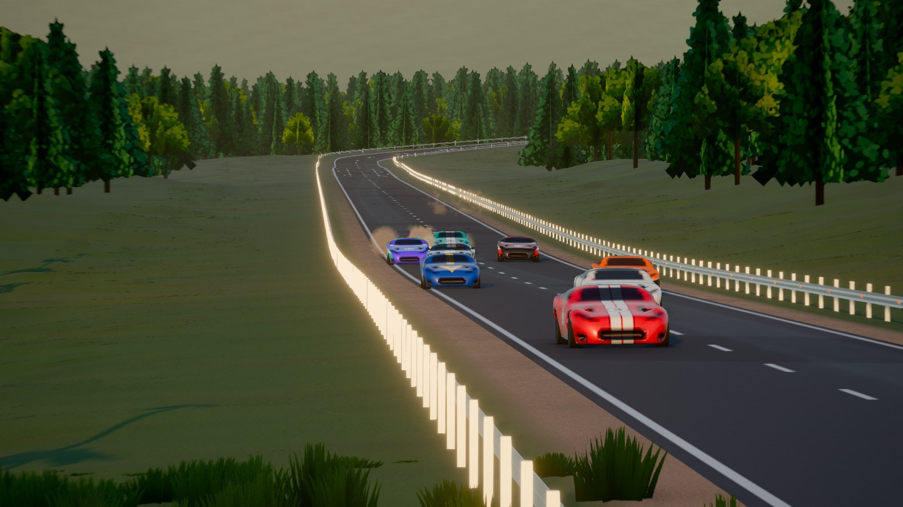
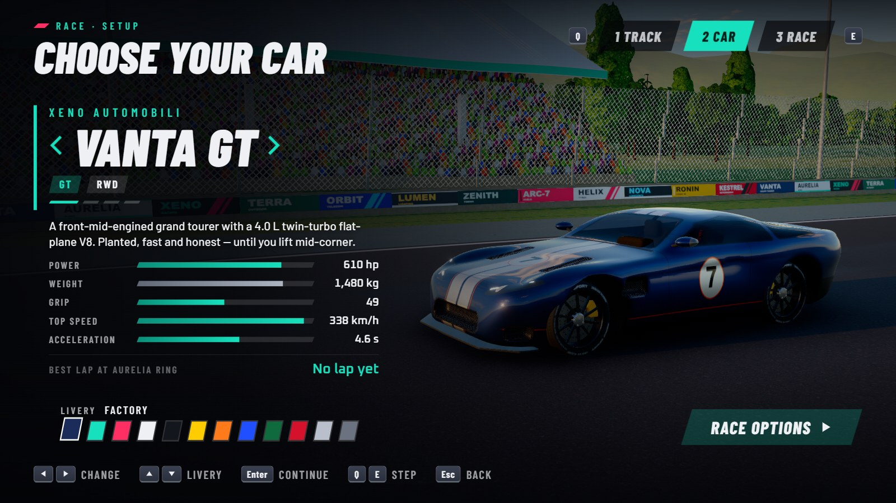

## Development

```
npm run dev        # dev server on :5199
npm run build      # type-check + production build into dist/
npm test           # vitest: physics, AI, handling, tracks, session, UI, audio, render
npm run typecheck
```

- The version is written in one place, `package.json`; the title screen and the credits read it from there. Bump it with `npm version patch` (or `minor`, `major`), which also updates `package-lock.json`.
- [`ARCHITECTURE.md`](ARCHITECTURE.md) describes the subsystems and the shared contracts in `src/core`.
- `sandbox/*.html` holds standalone labs for the car models, tracks, rendering, audio and UI.
- `scripts/tour.mjs` scripts a play-through in headless Chrome. It can wait, press keys, take screenshots, evaluate code and collect perf stats. With `--init scripts/fixtures/fake-pad.js` it drives a fake F310.
- `tests/probes/` holds diagnostics that only run on demand. For example, `PACKSET=1 npx vitest run tests/probes/pack.test.ts` runs the AI pack-racing benchmark, and `WXRACE=1 npx vitest run tests/probes/weather-race.test.ts` races the AI through a changing forecast (rain arriving, or clearing) and prints how clean it stays in each phase of the change. For the mechanical damage, `DMGRACE=1 npx vitest run tests/probes/damage-race.test.ts` races the same packs with Visual and with Full damage (and with half the field badly bent) and compares how clean each is, `DMGCAL=pull|grip|lap npx vitest run tests/probes/damage-calib.test.ts` shows what a given damage does to a car (the pull and the stick that holds it, top speed, lap times) and `STEPCOST=1 npx vitest run tests/probes/step-cost.test.ts` times the physics step with and without it. `BRAKEASSIST=1 npx vitest run tests/probes/brake-assist.test.ts` laps every circuit in every car with a driver that only steers (`TRACKS=`, `CARS=`, `WET=`, `AIDS=`, `STEER=` and `ASSIST=0` for the control run) and tabulates the laps, the time off the asphalt, the wall hits and how much the assist braked.

Dev URL flags: `?quick=race|timeTrial|freeRoam&track=aurelia|kuroyama|brennwald|portovela|isvik&car=vanta-gt&opp=7&laps=3&tod=night&weather=clear|cloudy|overcast|rain|storm&cam=tv&quality=low|medium|high|ultra&damage=off|visual|full&autopilot=1&ui=0`. `?quick=championship&car=&opp=&diff=&start=` starts a new Xeno Cup, and `&champlaps=1` makes every round that many laps (with `autopilot=1` it plays itself). `&players=2` (race or free roam) puts a second player on the same screen in `&car2=` and `&cam2=` (with `autopilot=1` both drive themselves; the fake pad of `scripts/fixtures/fake-pad.js` has a second pad, `window.__pad2`, that is unplugged unless the page has `pad2=1`). `&assists=pro|standard|beginner`, `&line=off|braking|full` and `&brakeassist=1` set player 1's aids for the session (`&assists2=`, `&line2=` and `&brakeassist2=` set player 2's; the braking assist leaves the pedals of `&autopilot=1` alone). `&forecast=rainLater|clearing` changes the weather during a race (`&wxseed=7` picks when and how hard, `&wxat=30` brings the change in 30 s after the start, `&wxspeed=10` runs it ten times faster).

## Credits

Surface textures are CC0 from [Poly Haven](https://polyhaven.com) (see `public/assets/track/CREDITS.md`).
Everything else is generated in code: cars, terrain, trees, buildings, signage, sky, engine sound and music.

Built by Claude (Anthropic) for Gabriel.

## License

Xeno-Racer is released under the [MIT License](LICENSE). The bundled fonts keep their own license, the SIL Open Font License 1.1 (`public/assets/ui/fonts/OFL-*.txt`), and the Poly Haven textures are CC0.
