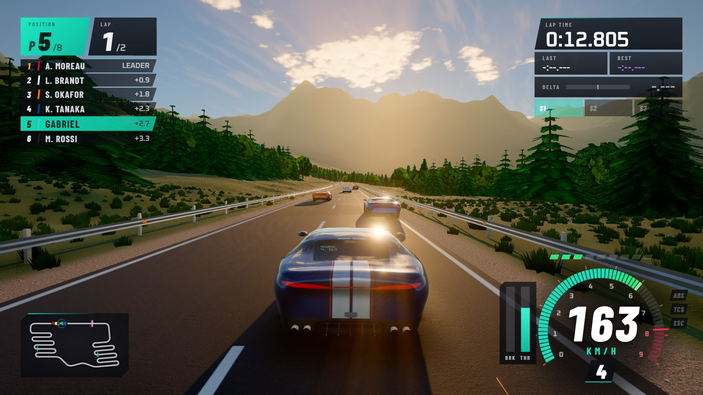
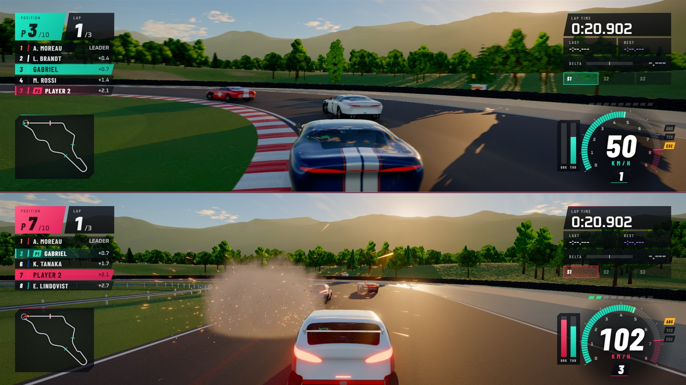
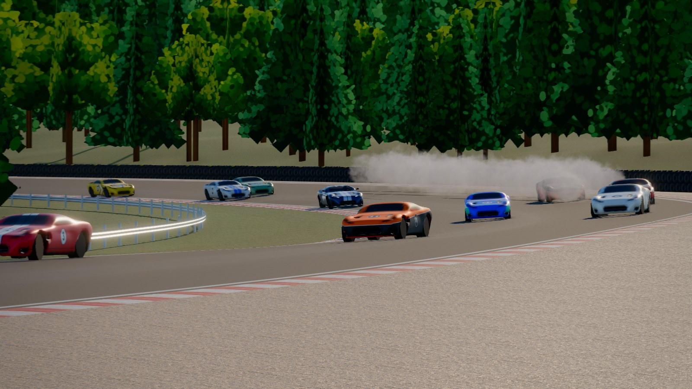
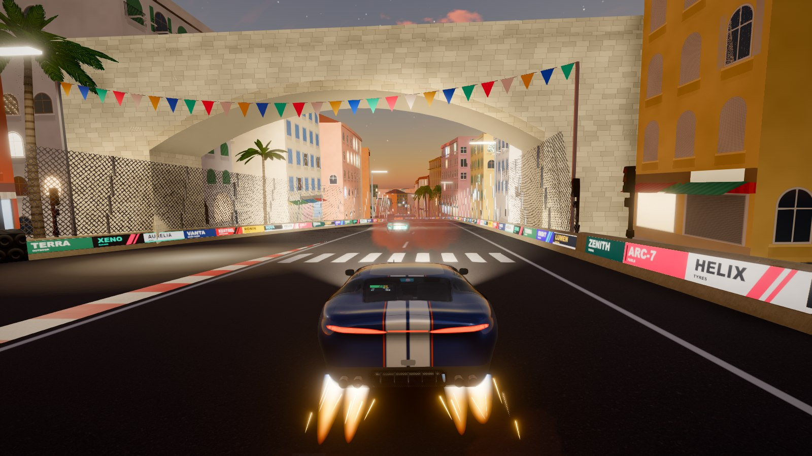
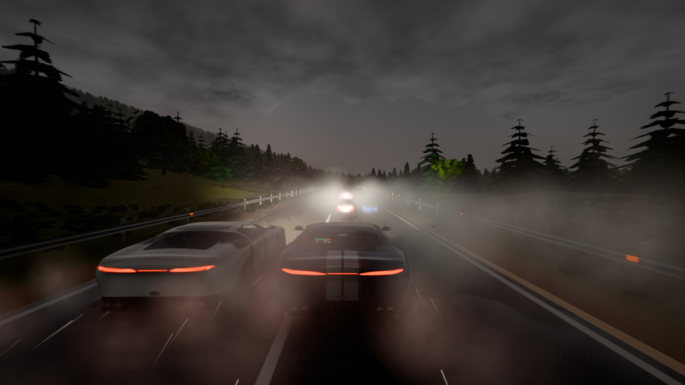
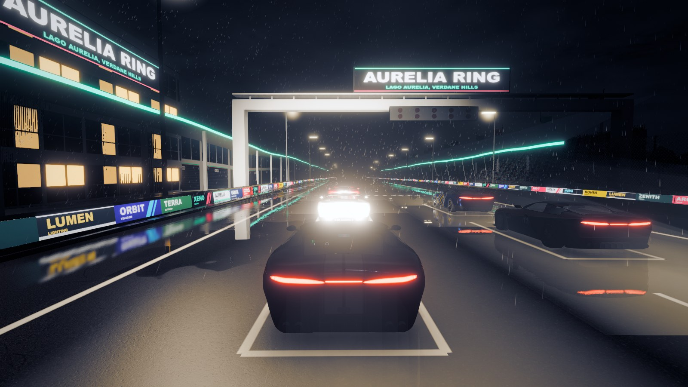
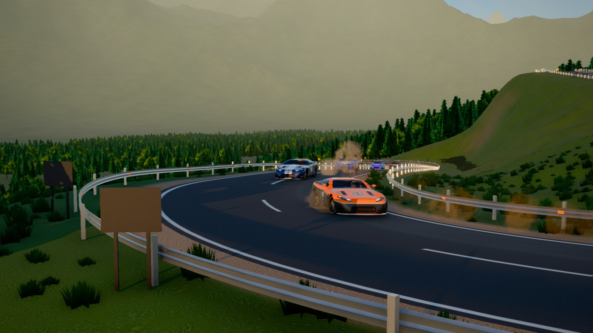
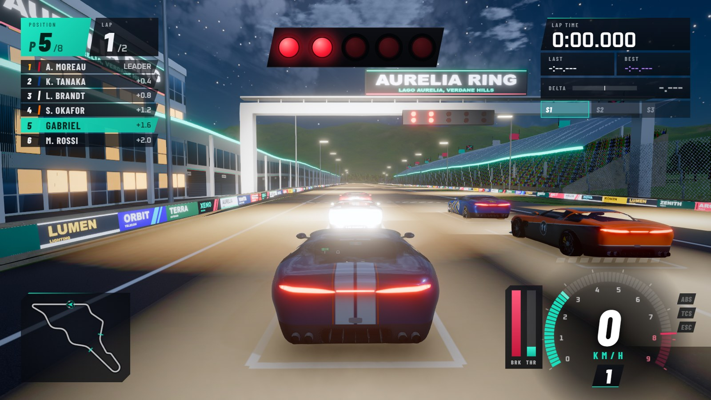
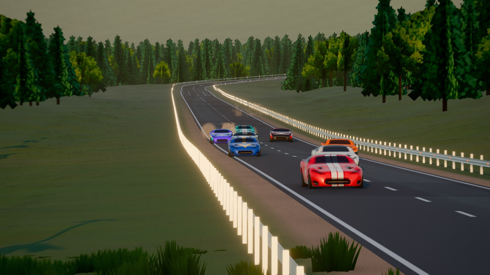
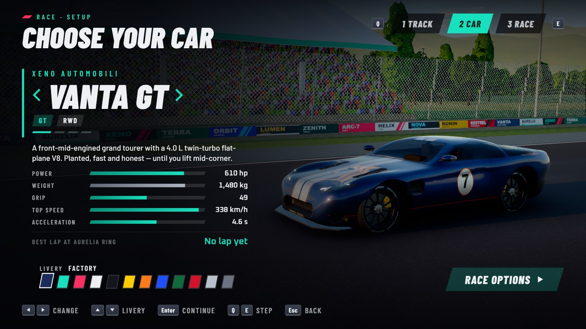

# Xeno-Racer

A realistic racing game for the browser, built for a gamepad. A from-scratch vehicle simulation
running at 1000 Hz, AI drivers that race wheel to wheel, four hand-built circuits from a mountain
pass to a floodlit harbour street circuit, rain that you can feel through the tyres, procedurally
sculpted cars that crumple when they hit something, working mirrors, synthesized engine sound, and
a TV director that films the race.



## Play

**Windows:** double-click **`play.bat`**. It needs [Node.js](https://nodejs.org) 20+ and Google Chrome.
On the first run it installs dependencies and builds the game, which takes about a minute. It then
opens Xeno-Racer full-screen in its own Chrome window, on the dedicated GPU. To quit, close the
window (**Alt+F4** in full screen).

- Plug in the gamepad and press any button. On a **Logitech F310**, set the switch on the back to **X** (XInput).
- `play.bat --window` plays in a window, `play.bat --build` forces a rebuild, `play.bat --dev` runs from the dev server with hot reload, and `play.bat --serve` only serves the game (open the printed address yourself).

**Any platform:** run `npm install`, then `npm run dev`, and open http://localhost:5199 in Chrome.

## Controls

| | Gamepad (Xbox layout) | Keyboard |
|---|---|---|
| Steer | Left stick | A / D or ← / → |
| Throttle / brake | RT / LT (analog) | W / S or ↑ / ↓ |
| Handbrake | A | Space |
| Shift up / down | RB or B / LB or X (manual gearbox) | E / Q |
| Camera | Y | C |
| Look around / look back | Right stick / click right stick | I J K L / V |
| Reset car to track | Back | R |
| Pause | Start | Esc |
| HUD / telemetry | D-pad up / D-pad down | H / T |

Menus use the D-pad or left stick: A confirms, B goes back, and LB/RB step between setup pages and settings tabs (in split screen, either player's pad works in the menus). Settings, Assists has the driving line, the braking assist and a Pro / Standard / Beginner preset, and a tab of its own for player 2 while a second controller is plugged in.
During a replay, LB/RB switch cars, Y changes the camera and B exits. On a pad with rumble
motors (the F310 has none), kerbs, wheelspin and impacts rumble. The race pauses itself when the
window loses focus.

## Modes

- **Race:** up to 11 AI opponents in four skill levels (rookie, amateur, pro, alien). Start-light countdown, pole/middle/back grid slot, 1–50 laps, time of day, weather and a forecast (rain that arrives part way through the race, or clears away). Results come with a full replay.
- **Time trial:** a rolling start, sector splits, and a live delta to your best lap, raced against the ghost of your personal best. Best laps and ghosts are saved per track and car.
- **Championship:** the Xeno Cup, eight rounds over all four circuits, each in different conditions (golden hour, a cloudy morning, a harbour dusk, a forest morning, dusk rain, night under the floodlights, a cloudy night in Porto Vela where the rain comes during the race, and a thunderstorm finale). Every race scores 25-18-15-12-10-8-6-4-2-1, plus a point for the fastest lap, with the standings and a calendar of winners after each round. Pick your car, difficulty, field (up to 11 opponents who keep their names and liveries all season), race length and how the grid is set. The season is saved after every round, so you can quit to the menu and carry on later, and it ends with a podium and your season summary.
- **Free roam:** the track to yourself.

Opponents drive the same car as you, so the racing is about driving, not horsepower.

## Split screen

Two players, one screen, two controllers. Choose **Split screen** in the main menu (or set **Players** to 2 in the Race and Free Roam setup). Each player picks their own car and livery with their own pad. The second player joins with "Player 2, press A to join" on a second controller; with only one controller, press Enter to play on the keyboard instead, and Y swaps who is player 1 and who is player 2. The time trial and the Xeno Cup stay one-player.



- **Layout:** two wide views, one above the other (each 1920×538 at 1080p), or side by side (Settings, Gameplay: Split screen layout). The lens of each view is set for its shape, so neither looks stretched or like a keyhole. A thin divider runs between them.
- **Everything is per player:** the camera (Y cycles, the right stick looks around, clicking it looks back, and the cockpit, hood and bumper views have their own interiors), the HUD, the spotter, the wrong-way warning, the rain on the windscreen with its wiper, and lap and sector timing. The tower shows both players, in teal and pink, and each minimap shows both. The telemetry overlay and the mirrors are off.
- **The grid:** the two cars start side by side at the position you chose, with up to 10 opponents, who drive the two players' cars in turn. Both players are on the tower, on the minimaps and on the results with their names (Settings, Gameplay: Player 2 name).
- **Assists:** each player has a set of their own (Settings, Assists P1 and Assists P2, each with the Pro, Standard and Beginner presets): one can drive a manual gearbox with nothing to help while the other has ABS, traction and stability control, the driving line and the braking assist on. An older save starts player 2 with what player 1 had, as both drove with before.
- **Pause:** either player's Start pauses the race for both and the pause menu follows the pad that paused. Unplugging a controller pauses the race and says whose it was.
- **Results:** both players in the standings, and a head-to-head card: who beat whom, by how much, and each player's laps. Best laps are saved per track and car for both players, each with its ghost lap for the time trial. No ghost is shown in a split race; the replay is the usual one-screen replay, from any car.
- **Sound:** each player's own engine is the close, full-bodied one; opponents, tyres and impacts are heard from the nearer player's car, and the two engines are a little left and right of each other.
- **Cost:** two views cost about as many pixels as one, but the scene, the shadows and the post chain are drawn twice. On the development laptop (RTX 3050, 1080p, High) a split race takes 8 to 10 ms of GPU a frame (a single-player race 6.6 to 7.4), 99 % of its frames take under 13 ms, and it holds 60 fps with room to spare; the Ultra preset's 1.25 supersampling is run at 1.0 while the screen is split. The shaders of both views are built behind the loading screen, as in a single-player race (it takes about a second longer), and none is built after the lights go out.

## On track

- **Damage:** a hit marks the car where it landed, in proportion to how hard it was. A tap leaves rubber and the other car's paint, a graze scrapes through to primer and bare metal (or frayed carbon), and a hard hit crushes a corner, buckles the bonnet, breaks a light and stars the glass. Every car takes it, the AI's too. Settings, Gameplay: Damage (Off, Visual or Full). Visual is the default.
  - **Full** adds mechanical damage. A hit counts from about 10 km/h of closing speed up, grows with the square of it and is shared out by where it landed, so taps, scrapes and the bumps of a pack race do nothing, and a real crash (a head-on hit from about 60 km/h, a 25 degree hit of a barrier from about 100 km/h) does something you can feel, and a hard one a good deal. It bends the wheels on the side that took it: the car pulls towards that side, it takes a stick held a tenth to a fifth of the way across to run straight, and the tyres scrub and lose a little grip (a bent tail makes it nervous). Up to 40 % of the downforce at the nose or the tail goes (a prototype feels it, a road car hardly), and a heavy front hit costs up to a tenth of the engine's power. It grows smoothly with how hard and how often you hit, and no car ever becomes undrivable: a badly bent one is slower (for an AI driver at the limit, 1 to 4 % of a lap in a road car and 2 to 5 % in the prototype) and trickier, and still finishes.
  - A small car outline on the HUD shows what is hurt, amber to red, for a few seconds after a hit, and the pause screen shows it for as long as the car is bent. The bent wheels are drawn leaning out. The AI drives the car it has, and brakes earlier and carries less speed where the lost downforce used to carry it. A restart or the next round of a championship repairs every car, and so does leaving Full (the dents stay in Visual); the Reset button does not repair; the time trial ghost is never hurt. Every mode but Off keeps the record of the hits, so switching to Full from the pause menu in the middle of a race puts on the cars the damage they already carry.
- **Driving line:** a Forza-style racing line on the road ahead (Settings, Assists: Off, Braking zones or Full): the AI's own line and speed profile, worked out for your car (an LMP-X brakes later than a Ronin) and the water on the road, drawn as chevrons that fade into the distance. Green means keep going, amber lift or brake soon, red brake now, measured against your speed, so it asks for earlier braking in the rain and follows a changing forecast. It shows in the chase, far chase, hood, bumper and cockpit views (not the TV, orbit or replay cameras, the photo mode or the attract race), and each split-screen view shows its own player's line. It costs no measurable GPU time (under 0.1 ms at 1080p High) and builds no shader after the lights go out.
- **Braking assist:** (Settings, Assists; off by default, meant for a young driver.) Brakes the car, smoothly and through ABS, when it comes into a corner faster than the driving line allows, and lifts the throttle while it does. You still steer and accelerate, and your own harder brake wins. The BRK bar shows what it adds in blue, with a "brake assist" cue. With the throttle flat out and the brake never touched, a car whose steering follows the line (the AI's path follower at the wheel) laps all four circuits, dry and wet, in all four cars, without a wall hit or a reset and never more than 0.8 m past the edge of the asphalt (`tests/probes/brake-assist.test.ts`).
- **Mirrors:** in the cockpit, a working interior mirror and door mirrors (the LMP-X has a rear-camera screen on the dash); in the hood and bumper views, a mirror strip at the top of the screen. Headlights behind you glare in them at night and rain beads on them.
- **Spotter:** the edge of the screen glows amber, then red, while a car is alongside you.
- **Cameras:** chase, far chase, hood, bumper, cockpit, TV and orbit. The right stick looks around, and clicking it looks back.
- **Replays:** every race can be watched again from start to finish, from any car and camera.

## Cars

All four are original designs, and their figures are measured in the simulation, not just quoted:

| | Layout | Power | Weight | 0–100 km/h | Top speed | Skidpad |
|---|---|---|---|---|---|---|
| **Vanta GT**: twin-turbo V8 grand tourer | Front-mid engine, RWD | 610 hp | 1480 kg | 4.6 s | 340 km/h | 1.08 g |
| **Kestrel R**: turbo hot hatch | FWD | 320 hp | 1320 kg | 5.6 s | 270 km/h | 1.01 g |
| **Ronin 86**: naturally aspirated boxer coupé | RWD | 240 hp | 1200 kg | 6.6 s | 254 km/h | 0.99 g |
| **LMP-X**: V10 prototype with real downforce | Mid-engine, RWD | 690 hp | 950 kg | 2.6 s | 318 km/h | 1.92 g |

## Tracks

- **Aurelia Ring** (4.79 km, 14 corners) is a grand-prix circuit around a lake. It has a 940 m main straight into a hairpin, flowing esses, a banked carousel, a chicane and a downhill braking zone. Floodlit at night.
- **Kuroyama Pass** (5.25 km) is a mountain road climbing 140 m through twelve switchback hairpins, with a ridge section, a tunnel and a fast descent. The road is narrow and guard-railed.
- **Brennwald Ring** (6.84 km) is a fast, old-school circuit cut through pine and beech forest. It plunges 650 m downhill into the Kessel compression, climbs the steep Kesselwand and a kilometre-long uphill straight to a hairpin, then goes over a blind crest, through a fast double apex and a chicane before the line. 90 m of elevation change.

- **Porto Vela** (3.96 km) is a floodlit street circuit through a Mediterranean harbour town, between concrete walls and catch fences. A 660 m quay straight ends in a heavy braking zone, then the road climbs through the old town past a cathedral at a tight hairpin, dives through a 210 m tunnel under the castle hill and comes down an 8 % descent to a chicane by the marina. The windows light up at dusk.




Six times of day (dawn to night) and five weathers (clear, cloudy, overcast, rain and storm), all
lit by a physically based sky.

## Rain

Rain changes how the car drives as well as how it looks:

- **Grip:** measured on the skidpad, wet tarmac keeps 57-82 % of the dry grip, depending on the car
  and how wet it is. Stopping from 100 km/h needs 18-78 % more distance. Standing water makes the
  car aquaplane at speed. Kerbs, painted lines and grass are slippery. The water cools the tyres,
  and their working temperature drops by about 30 °C.
- **AI drivers:** they brake earlier, carry less speed and stay off the kerbs.
- **Visuals:** the sky closes into a low, dark cloud deck. The track darkens and shines, and puddles
  reflect the lights and ripple. Cars throw up spray and rooster tails. Droplets bead on the
  paintwork and slide up the windscreen in the cockpit view, where the wiper sweeps them away.
- **Storms:** visibility drops to a few hundred metres, and lightning lights up the clouds, with the
  thunder rolling in a moment later.
- **Sound:** the rain patters or roars, drums on the roof from inside the car, and the tyres hiss
  and spray. In the cockpit the wiper motor whines and the blade thunks at each end of its sweep.
- **Records:** wet best laps and ghosts are kept apart from dry ones. In a race whose weather changes, a lap counts as wet if the track was wet at any point of it.

### Weather that changes

The setup's **Forecast** row (Stable, Rain later, Clearing) makes the weather move during a race. It is offered where it makes sense: rain later from a dry start (clear, cloudy or overcast), clearing from rain or a storm, in races of two laps or more and in free roam.

- **Rain later:** the race starts dry. Somewhere between 30 and 65 % of the way through (by the leader's progress) a notice says "Rain is coming", the sky darkens over a minute, and about 35 s later the first drops land on the windscreen. The rain builds for one to two minutes into a shower or, now and then, a storm. The track takes the water with a lag of about a lap, so grip fades over a lap or two, the AI drivers brake earlier as it goes, and spray and puddles grow.
- **Clearing:** the race starts wet. The rain eases and stops, the cloud deck lifts, and the track dries a good deal more slowly than it wet, over several minutes.
- **Smooth, and the same every time:** the sky, light, fog, exposure, rain, sound and the water on the road all move continuously, the lightning only strikes in storm-strength rain, and a restart repeats the same weather. A broadcast notice marks the moment, and a chip under the lap timer shows the sky and how wet the track is. Both the dry and the wet look are prepared behind the loading screen, so nothing is compiled or switched on once the race is running.
- **Free roam** brings the change in a minute or two after the start. A time trial stays as set.






## Under the hood

- **Vehicle physics** (`src/physics`) is written from scratch and steps at 1000 Hz:
  - **Tires:** combined-slip tire model with relaxation length, load sensitivity, and tread and brake temperatures. In the wet, grip depends on the surface and each tyre's wet compound, and the car aquaplanes in standing water.
  - **Suspension:** raycast suspension with anti-roll bars.
  - **Drivetrain:** engine torque curves with turbo lag, a clutch and gearbox solved implicitly, and a limited-slip differential.
  - **Aero:** drag, downforce and slipstream.
  - **Driver aids:** ABS, traction control and stability control, plus a speed-sensitive steering filter tuned for a thumbstick. Above the physics, per human driver: the driving line and the braking assist (`src/core/aids.ts`).
  - **Collisions:** car-to-car and car-to-wall, with sparks and scrapes. Every impact is reported with its closing speed, contact point and normal.
  - **Mechanical damage:** what the hits did to a car (`Vehicle.setDamage`, from `src/core/mechanical.ts`) is toe and camber on each wheel, downforce at each axle and engine torque. The toe turns the wheel a little off true, so the wheel angle the car visual and the replays draw shows it; nothing allocates in the 1000 Hz step, and a sound car runs the same code with neutral numbers.
  - **Cost:** twelve cars cost about 0.6 ms per frame.
- **AI** (`src/ai`) works in four layers:
  - A minimum-curvature racing line, with a speed profile from the friction circle, downforce and banking.
  - A path-tracking steering controller.
  - A traffic planner that holds its lane alongside other cars, commits to passes, leaves room, and follows at a safe gap when it can't get by.
  - Measured over 10 benchmark races: no resets, almost no time off the track, and around 200 overtakes.
  - A car with mechanical damage is driven by a driver that knows it (`AIDriver.setDamage`): the speed profile is worked out again for the car as it is now, a part of what the damage took, so it brakes earlier and carries less speed in the corners the lost downforce used to carry.
- **Rendering** (`src/render`, `src/carvis`, `src/track`) is three.js on WebGL2:
  - **Lighting and post:** cascaded sun shadows, ambient occlusion, bloom, sun shafts, motion blur and AgX tone mapping. At night, unlit scenery shifts toward the blue-grey the eye sees in the dark.
  - **Weather:** a rain-deck sky, rain particles, wet materials, puddles with screen-space reflections, spray, windscreen droplets and lightning. In a race whose weather changes, the two skies are blended every frame (the shadow cascades, the headlights and the wet-road and windscreen passes are all prepared for both).
  - **Cars:** sculpted from signed distance fields, with liveries, working lights, interiors, and a driver who turns the wheel.
  - **Damage:** dents, creases, scrapes, broken lamps and cracked glass are drawn by each car's own shaders from a small fixed set of uniforms, so a first hit never compiles a shader. `src/core/damage.ts` folds each car's hits into that record, `src/core/mechanical.ts` into what they do to how it drives (Damage: Full), and replays rebuild the damage of every moment. Bent wheels are drawn leaning out a little more than they are.
  - **Mirrors:** each mirror is the scene drawn again from the driver's reflected eye into a small HDR texture, reusing the frame's shadow maps. They add about 0.6 ms of GPU and 1-2 ms of CPU time per frame at 1080p high, and less on the lower presets.
  - **Tracks:** terrain, trees, buildings and props are all procedural, plus CC0 surface textures. Porto Vela's town is built from instanced blocks whose windows, shutters and shop fronts are drawn in the fragment shader.
  - **Performance:** the high preset renders 1080p in 7.5 to 10 ms on an RTX 3050 laptop GPU, depending on the track and the weather. Shaders are compiled behind the loading screen, not in the first frames of the race.
- **Audio** (`src/audio`) synthesizes engines in AudioWorklets, with intake, exhaust, turbo whistle, backfires, tire squeal, wind, impacts and 3D positioning. It also synthesizes rain (outside and inside the car), rolling thunder, wet-tyre hiss and spray, and the cockpit wiper, timed to the blade on screen.




## Development

```
npm run dev        # dev server on :5199
npm run build      # type-check + production build into dist/
npm test           # vitest: physics, AI, handling, tracks, session, UI, audio, render
npm run typecheck
```

- [`ARCHITECTURE.md`](ARCHITECTURE.md) describes the subsystems and the shared contracts in `src/core`.
- `sandbox/*.html` holds standalone labs for the car models, tracks, rendering, audio and UI.
- `scripts/tour.mjs` scripts a play-through in headless Chrome. It can wait, press keys, take screenshots, evaluate code and collect perf stats. With `--init scripts/fixtures/fake-pad.js` it drives a fake F310.
- `tests/probes/` holds diagnostics that only run on demand. For example, `PACKSET=1 npx vitest run tests/probes/pack.test.ts` runs the AI pack-racing benchmark, and `WXRACE=1 npx vitest run tests/probes/weather-race.test.ts` races the AI through a changing forecast (rain arriving, or clearing) and prints how clean it stays in each phase of the change. For the mechanical damage, `DMGRACE=1 npx vitest run tests/probes/damage-race.test.ts` races the same packs with Visual and with Full damage (and with half the field badly bent) and compares how clean each is, `DMGCAL=pull|grip|lap npx vitest run tests/probes/damage-calib.test.ts` shows what a given damage does to a car (the pull and the stick that holds it, top speed, lap times) and `STEPCOST=1 npx vitest run tests/probes/step-cost.test.ts` times the physics step with and without it. `BRAKEASSIST=1 npx vitest run tests/probes/brake-assist.test.ts` laps every circuit in every car with a driver that only steers (`TRACKS=`, `CARS=`, `WET=`, `AIDS=`, `STEER=` and `ASSIST=0` for the control run) and tabulates the laps, the time off the asphalt, the wall hits and how much the assist braked.

Dev URL flags: `?quick=race|timeTrial|freeRoam&track=aurelia|kuroyama|brennwald|portovela&car=vanta-gt&opp=7&laps=3&tod=night&weather=clear|cloudy|overcast|rain|storm&cam=tv&quality=low|medium|high|ultra&damage=off|visual|full&autopilot=1&ui=0`. `?quick=championship&car=&opp=&diff=&start=` starts a new Xeno Cup, and `&champlaps=1` makes every round that many laps (with `autopilot=1` it plays itself). `&players=2` (race or free roam) puts a second player on the same screen in `&car2=` and `&cam2=` (with `autopilot=1` both drive themselves; the fake pad of `scripts/fixtures/fake-pad.js` has a second pad, `window.__pad2`, that is unplugged unless the page has `pad2=1`). `&assists=pro|standard|beginner`, `&line=off|braking|full` and `&brakeassist=1` set player 1's aids for the session (`&assists2=`, `&line2=` and `&brakeassist2=` set player 2's; the braking assist leaves the pedals of `&autopilot=1` alone). `&forecast=rainLater|clearing` changes the weather during a race (`&wxseed=7` picks when and how hard, `&wxat=30` brings the change in 30 s after the start, `&wxspeed=10` runs it ten times faster).

## Credits

Surface textures are CC0 from [Poly Haven](https://polyhaven.com) (see `public/assets/track/CREDITS.md`).
Everything else is generated in code: cars, terrain, trees, buildings, signage, sky, engine sound and music.

Built by Claude (Anthropic) for Gabriel.
